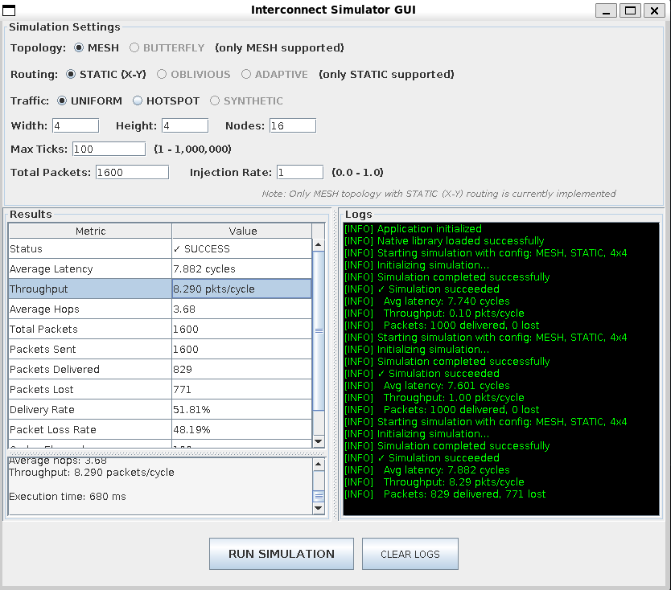

# NoC-sim

A cycle-stepped, packet-level Network-on-Chip (NoC) simulator for studying traffic movement, contention, and backpressure in rectangular 2-D mesh networks. The project combines a C++17 simulation kernel with a Java Swing interface connected through the Java Native Interface (JNI).

## Overview

NoC-sim models packets moving between nodes in a non-wrapping mesh. Each router applies deterministic X-first dimension-order routing, collects requests from its input ports, arbitrates output contention, and forwards successful transfers through buffered directed ports.

The simulator operates at the packet level: packets are transferred atomically rather than being divided into flits. Its primary use is architectural experimentation and education around mesh construction, routing, buffering, arbitration, traffic generation, and simulation timing.

The Java frontend configures and launches simulations, while the C++ API additionally supports trace generation, replay, step-by-step execution, and JSON result export.

## Key Features

- Parameterized rectangular 2-D mesh topology.
- Deterministic X-first X-Y routing.
- Cycle-stepped router and port updates.
- Buffered ports with delayed visibility and backpressure.
- Request, arbitration, and transfer phases inside each router.
- Stateful round-robin contention resolution.
- Uniform-random and hotspot traffic through the GUI.
- Transpose, bit-reversal, and shuffle patterns through the C++ API.
- JSON packet-trace import/export and result persistence.
- Delivery, latency, hop, throughput, and per-node retry statistics.
- Java Swing frontend connected to the C++ kernel through JNI.
- GoogleTest component and simulation tests.



## Architecture

```text
Java Swing GUI
      |
      | SimulationConfig
      v
SimulationService
      |
      | JSON over JNI
      v
C++ SimulationController
      |
      +---- PacketTrace
      |
      +---- NetworkNode[] ---- local injection/ejection ports
      |
      +---- MeshInterconnect
                |
                +---- MeshRouter[]
                |
                +---- directed Port objects
```

A simulation tick is divided into three system-level stages:

1. **Network nodes** attempt scheduled packet injections and drain packets already visible at local ejection ports.
2. **Routers** collect routing requests, arbitrate conflicts, and transfer winning packets to output ports.
3. **Ports** commit pending transfers, making them visible to receivers on a later tick.

Because all routers execute before the port commit phase, a packet cannot traverse multiple routers during one simulation tick.

### Packet Path

```text
Traffic trace
     |
     v
Source NetworkNode
     |
     v
LOCAL injection port
     |
     v
MeshRouter -- directed inter-router ports --> MeshRouter
     |
     v
LOCAL ejection port
     |
     v
Destination NetworkNode
```

## Important Implementation Details

### Mesh Topology and Routing

Routers are numbered in row-major order:

```text
node_id = y * width + x
```

Each router defines north, east, south, west, and local directions. Boundary directions remain disconnected, while every router receives separate local injection and ejection ports.

Routing first resolves the X coordinate by moving east or west. Once the destination column is reached, the packet moves north or south along the Y dimension. At the destination router, it is routed to the local output.

### Router Pipeline and Arbitration

Each router tick has three phases:

1. **Collect:** inspect the head packet of every non-empty input and determine its requested output.
2. **Arbitrate:** select at most one requesting input for each output.
3. **Send:** transfer winners whose output ports can accept a packet.

Multiple packets can move through a router during one tick when they target different outputs. Each output accepts at most one packet per tick.

Contention is resolved by a stateful round-robin arbiter. The current implementation uses one shared arbiter state per router, so arbitration histories for different outputs are coupled.

### Buffered Ports and Backpressure

A port contains separate pending-send and readable-receive storage. A packet written during tick `T` becomes readable no earlier than tick `T+1`. If readable storage remains occupied, the pending packet waits in the send stage.

Routers remove a packet from an input only when the selected output can accept it. Blocked packets therefore remain buffered and are retried instead of being intentionally dropped.

### Traffic and Statistics

The GUI supports:

- uniform-random source/destination traffic;
- hotspot traffic, currently fixed to node `0` with a hotspot ratio of `0.5`.

The lower-level C++ API also implements transpose, bit-reversal, and shuffle patterns, plus JSON trace loading and saving.

Reported data includes delivered and cutoff-undelivered packet counts, average latency, average router traversals, a simple delivered-packets-per-configured-tick throughput value, and per-node injection, reception, and retry counters.

## Repository Structure

```text
src/
|-- interconnect/
|   |-- core/          # Packets, ports, router base class, and arbiter
|   |-- mesh/          # Mesh construction, coordinates, and X-Y routing
|   |-- network/       # Traffic traces, endpoints, controller, and statistics
|   `-- butterfly/     # Placeholder for a future topology
|-- Interface/         # Java Swing GUI, models, and services
`-- JNI/               # Native bridge, validation, and simulation runner

tests/                 # GoogleTest component and simulation tests
test_results/          # Example JSON traces and simulation results
lib/java/              # Bundled JSON-java dependency
readme_pics/           # GUI screenshot
```

## Getting Started

### Prerequisites

The default build requires:

- CMake 3.10 or newer;
- a C++17 compiler;
- a JDK with JNI headers;
- nlohmann/json with its CMake package;
- GoogleTest when `BUILD_TESTS=ON`;
- a graphical environment for the Swing application.

On Ubuntu or Debian:

```bash
sudo apt update
sudo apt install -y build-essential cmake default-jdk nlohmann-json3-dev libgtest-dev
```

The repository already contains the required JSON-java JAR.

### Build

The current checkout contains two CMake files whose capitalization is incompatible with case-sensitive CMake lookup. Correct their names once before configuring:

```bash
mv src/interconnect/mesh/CmakeLists.txt \
   src/interconnect/mesh/CMakeLists.txt

mv src/interconnect/network/CmakeLists.txt \
   src/interconnect/network/CMakeLists.txt
```

Then configure and build from the repository root:

```bash
cmake -S . -B build
cmake --build build -j
```

Tests can be excluded with:

```bash
cmake -S . -B build -DBUILD_TESTS=OFF
```

### Run the GUI

```bash
cmake --build build --target run
```

JNI checking can be enabled with:

```bash
cmake --build build --target debug
```

The application has no command-line simulation interface; topology and traffic parameters are entered through the GUI.

## C++ API Example

The integration tests use `SimulationController` directly:

```cpp
SimulationController sim;

sim.setup_mesh(2, 2);
sim.generate_uniform_trace(
    50,    // packets
    0.2,   // traffic-rate parameter
    100    // trace time range
);

sim.run(100);
sim.save_results("test_results/2x2_uniform.json");
```

The controller also provides hotspot and synthetic trace generation, trace replay, and single-step execution.

## Testing

Build and invoke all registered GoogleTest executables with:

```bash
cmake --build build --target run_all_tests
```

The test suite covers ports, arbitration, coordinate utilities, routing, mesh integration, traffic generation, trace replay, and complete simulations.

Some timing tests still assume an earlier immediate-delivery port model and have not been reconciled with the current staged-port semantics. The test suite should therefore be considered work in progress rather than evidence that the current revision passes unchanged.

## Technologies

- C++17
- Java Swing
- Java Native Interface (JNI)
- CMake
- GoogleTest and CTest
- nlohmann/json
- JSON-java
- Doxygen

## Current Status and Limitations

NoC-sim is an educational prototype rather than a flit-accurate or RTL-equivalent NoC model.

- Only rectangular mesh topology and fixed X-Y routing are implemented.
- Packets are atomic; there are no flits, virtual channels, packet serialization, link-width timing, or reassembly.
- Packet size and traffic type metadata do not affect transport latency.
- Traffic generation uses nondeterministic seeding by default.
- Hotspot parameters are not configurable through the GUI.
- "Lost" currently means not delivered before the simulation cutoff; the network does not model an explicit packet-drop mechanism.
- Maximum latency is not yet calculated by the JNI result path.
- Butterfly topology, adaptive routing, database storage, and live network visualization are placeholders or planned work.

## References

1. Natalie Enright Jerger and Li-Shiuan Peh, *On-Chip Networks*, Morgan & Claypool Publishers, 2017.
2. William J. Dally and Brian Towles, *Principles and Practices of Interconnection Networks*, Morgan Kaufmann, 2004.
